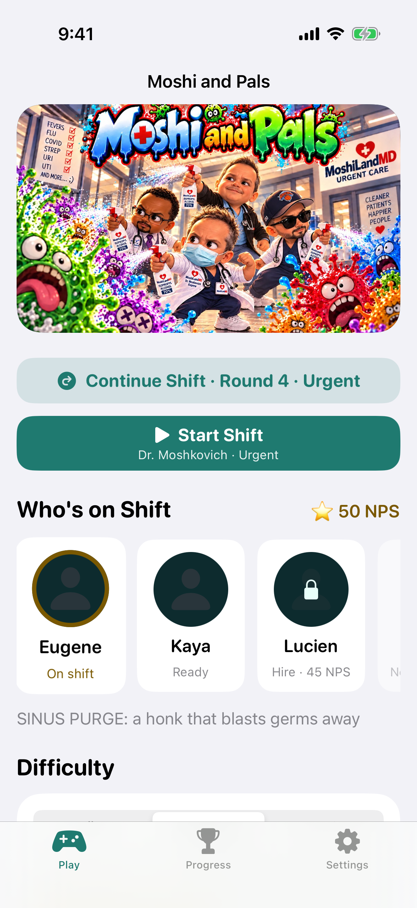
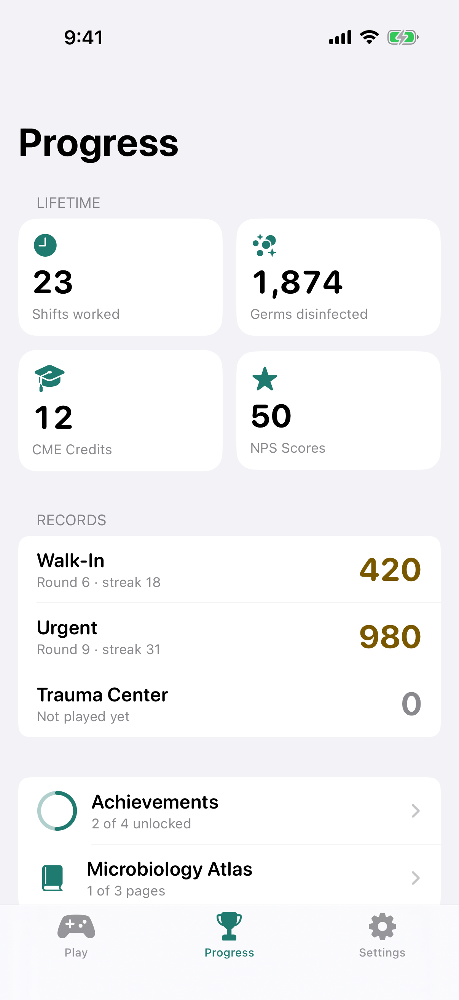

# Moshi and Pals

A comedic wave-survival game for iPhone. Dr. Eugene "Moshi" Moshkovich and his Pals versus the germs, in an urgent care clinic that has seen better days.

It ships two ways from this one repo:

- **iPhone app** (`ios/`): a native SwiftUI app with the game bundled inside. It works offline, has haptics, and supports dark mode and Dynamic Type.
- **Web** at https://ndabney562.github.io/moshi-and-pals/ (in Safari: Share → Add to Home Screen).

| Play | Progress | Settings (dark) | In a shift |
|---|---|---|---|
|  |  |  |  |

## Features

- **Four playable Pals.** Dr. Moshkovich, Dr. Kaya, PA Lucien and Ken each have a signature move. You hire them with NPS Scores.
- **Waves of germs** in a clinic you buy open room by room. Includes Sneezers, Spore Pods, Bacillus Bulldozers, and the bosses Diamond the Practice Manager and Patient Zero.
- **Absurd disinfection gear:** Lysol Fogger, Bleach Super Soaker, UV Wand, Gel Launcher, Defib Paddles and more.
- **Helpers:** Omar and Alan (scribes), Donald (X-ray), and Selina and Elaine at the front desk.
- **Today's Shift:** a daily challenge with two modifiers, the same for everyone.
- **Between shifts:** the Residency Board, the Equipment Locker, 27 achievements and the Microbiology Atlas.
- **Save & Quit:** pick a shift back up at the start of its round.

What the iPhone app adds:

- Native SwiftUI menus: pick a Pal and difficulty, Today's Shift, records, achievements, the Atlas and settings.
- Haptics when you're hit, use a Sinus Purge, meet or beat a boss, or unlock something. You can turn them off.
- Light and dark mode, Dynamic Type, VoiceOver labels, and colors that adapt to Increase Contrast.
- Portrait menus and a landscape game. The game runs offline from a copy bundled in the app.

## Run the iPhone app

You need:

- A Mac with **Xcode 16** or newer (iOS 17+ SDK)
- **Node.js 22** (`brew install node`). The build bundles the web game into the app.

Steps:

1. Clone the repo, then run `npm ci` in its root.
2. Open `ios/MoshiAndPals.xcodeproj` in Xcode.
3. Pick an iPhone simulator and press **Run** (⌘R).

The **Bundle the game** build phase runs `scripts/ios-bundle-web.sh`. That script builds the game with Vite into `ios/build/web` and copies it into the app. It only rebuilds when the game's files change.

**To run on your own iPhone:**

1. Select the **MoshiAndPals** target, open **Signing & Capabilities**, and pick your **Team**.
2. If Xcode says the bundle ID is taken, change `com.ndabney562.moshiandpals` to one you own.

**Tests:** in Xcode, ⌘U on the MoshiAndPals scheme runs the UI tests. For the logic unit tests, pick the **MoshiKit** scheme and press ⌘U. From the command line:

```
swift test --package-path ios/MoshiKit          # logic unit tests, no simulator needed
xcodebuild test -project ios/MoshiAndPals.xcodeproj -scheme MoshiAndPals \
  -destination 'platform=iOS Simulator,name=iPhone 16'
```

## Develop the game (web)

```
npm install
npm run dev      # local server; open the printed URL (works on a phone on the same Wi-Fi)
npm run build    # type-check and build to dist/
npm run smoke    # phone-sized browser test of the build
```

## How it fits together

```
src/                 the game (TypeScript + Phaser 3), shared by the web and the app
  core/native.ts     the bridge the iPhone app talks to (only active with ?native)
ios/
  MoshiAndPals/      SwiftUI app: App/, DesignSystem/ (Theme.swift), Features/, Services/
  MoshiKit/          Swift package: models, the bridge protocol, the store and view models (MVVM), unit tests
  MoshiAndPalsUITests/
scripts/ios-bundle-web.sh   builds the game into the app
```

The app keeps one `WKWebView` running the bundled game. While the menus are showing, the game's loop is asleep. The SwiftUI screens send commands through `window.moshiNative`, like "start a shift", "open the board" or "change a setting". The game answers through a `WKScriptMessageHandler` with a snapshot of the saves, haptic cues, and "back to the menu". More detail is in [docs/ARCHITECTURE.md](docs/ARCHITECTURE.md).

Docs live in [`docs/`](docs/): design, architecture, assets, backlog, bugs, balance, changelog, contributions. See [CONTRIBUTING.md](CONTRIBUTING.md) to help out.

## License

The code is under the [MIT License](LICENSE). The poster, app icon and characters are Noah's and are not covered by it.
