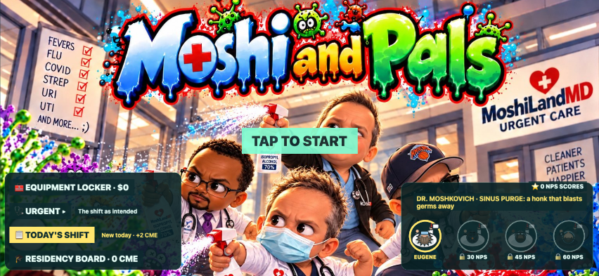
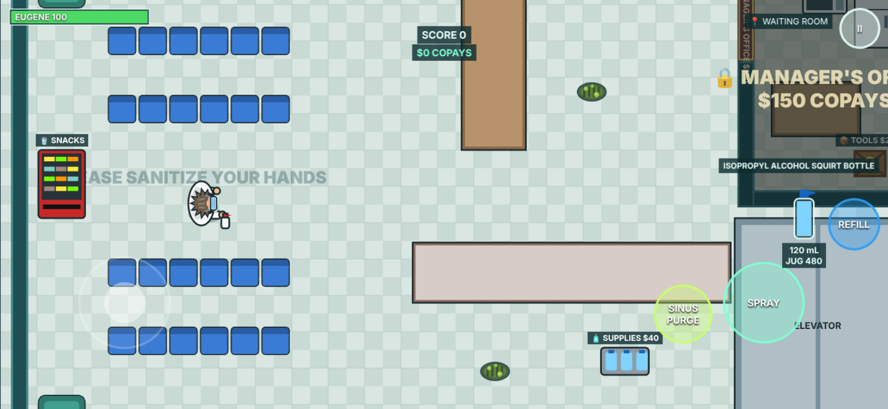
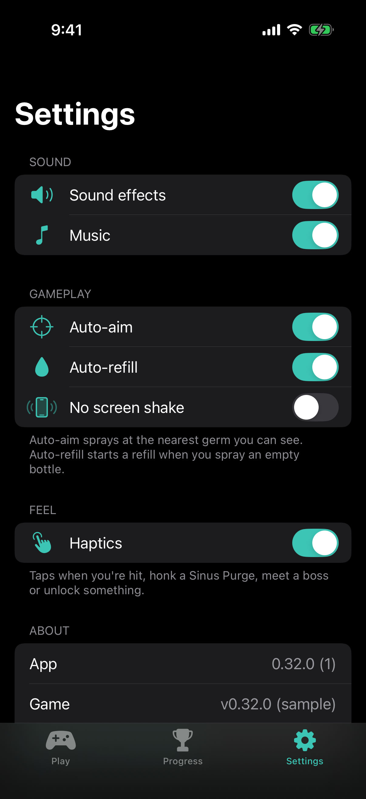

# Moshi and Pals

A comedic wave-survival game for iPhone. Dr. Eugene "Moshi" Moshkovich and his Pals versus the germs, in an urgent care clinic that has seen better days.

It ships two ways from this one repo:

- **iPhone app** (`ios/`): a SwiftUI shell with the game bundled inside. It works offline and adds haptics, a native Settings sheet and Game Center.
- **Web** at https://ndabney562.github.io/moshi-and-pals/ (in Safari: Share → Add to Home Screen).

| Title screen | In a shift | Settings sheet (dark) |
|---|---|---|
|  |  |  |

## Features

- **Four playable Pals.** Eugene, Kaya, Lucien and Ken each have a signature move. You hire them with NPS Scores.
- **Waves of germs** in a clinic you buy open room by room. Includes Sneezers, Spore Pods, Bacillus Bulldozers, and the bosses Diamond the Practice Manager and Patient Zero.
- **Absurd disinfection gear:** Lysol Fogger, Bleach Super Soaker, UV Wand, Gel Launcher, Defib Paddles and more.
- **Helpers:** Omar and Alan (scribes), Donald (X-ray), and Selina and Elaine at the front desk.
- **Today's Shift:** a daily challenge with two modifiers, the same for everyone.
- **Between shifts:** the Residency Board, the Equipment Locker, 27 achievements and the Microbiology Atlas.
- **Save & Quit:** pick a shift back up at the start of its round.

What the iPhone app adds:

- The same title screen and menus as the web (Providers, Locker, Board, Atlas, Today's Shift), so nothing is missing in the app.
- A native Settings sheet behind the title's gear, with haptics and the app and game versions.
- Game Center behind the LEADERBOARD tab: best scores per difficulty and achievements.
- Haptics when you're hit, use a Sinus Purge, meet or beat a boss, or unlock something. You can turn them off.
- Landscape only. The game runs offline from a copy bundled in the app.

## Run the iPhone app

You need:

- A Mac with **Xcode 16** or newer (iOS 17+ SDK)
- **Node.js 22** (`brew install node`). The build bundles the web game into the app.

Steps:

1. Clone the repo, then run `npm ci` in its root.
2. Open `ios/MoshiAndPals.xcodeproj` in Xcode.
3. Pick an iPhone simulator and press **Run** (⌘R).

The **Bundle the game** build phase runs `scripts/ios-bundle-web.sh`. It verifies the sealed `dist/` artifact, copies the exact files through `ios/build/web` into the app, and rebuilds only if the sources changed. `MOSHI_WEB_BUNDLE=/absolute/path/to/dist` requires an already verified artifact and refuses stale inputs. Both Pages and iOS use relative asset URLs and identical game files.

**To run on your own iPhone:**

1. Select the **MoshiAndPals** target, open **Signing & Capabilities**, and pick your **Team**.
2. If Xcode says the bundle ID is taken, change `com.ndabney562.moshiandpals` to one you own.

**Tests:** in Xcode, ⌘U on the MoshiAndPals scheme runs the UI tests. For the logic unit tests, pick the **MoshiKit** scheme and press ⌘U. From the command line:

```
swift test --package-path ios/MoshiKit          # logic unit tests, no simulator needed
xcodebuild test -project ios/MoshiAndPals.xcodeproj -scheme MoshiAndPals \
  -destination 'platform=iOS Simulator,name=iPhone 16'
```

## Develop the game (web)

```
npm install
npm run dev      # local server; open the printed URL (works on a phone on the same Wi-Fi)
npm run build    # type-check and build to dist/
npm run smoke    # phone-sized browser test of the build
```

## Local QA gate

Use Node 22 to match CI. The test tools are free and run locally.

1. Run `npm ci` to install locked dependencies.
2. Run `npx playwright install chromium webkit` to install browser engines. Tests use installed Google Chrome when available; `CHROMIUM_PATH` overrides it.
3. Run `npm run test:baseline` for test typechecking, isolated unit tests, the production build, artifact parity checks, and Chrome/WebKit regressions at `/moshi-and-pals/`.
4. Run `npm run smoke` for the preserved full gameplay smoke suite, or `npm run test:all` for both gates in sequence.
5. Review `test-results/unit.json`, `test-results/regression.json`, and failure screenshots/traces. Reports are ignored by Git.

`npm run test:watch` watches unit tests. Set `REGRESSION_PORT` or `SMOKE_PORT` if the default local ports (4174 and 4173) are occupied. If browser downloads use a custom `PLAYWRIGHT_BROWSERS_PATH`, supply that same variable when running tests.

The suite covers saves/migrations, rewards/purchases, equipment timing, seeded shifts, Pal dialogue selection, bridge commands, real browser transitions, mobile layouts, and controlled offline reload. Native bridge browser tests emulate the host; the simulator suite also boots the real bundled WKWebView, starts a shift, and relaunches the app. See [the remaster QA report](docs/archive/REMASTER-v2-QA.md) for measured results and remaining checks.

## How it fits together

```
src/                 the game (TypeScript + Phaser 3), shared by the web and the app
  core/native.ts     the bridge the iPhone app talks to (active with ?native and a callable host)
ios/
  MoshiAndPals/      SwiftUI app: App/, DesignSystem/ (Theme.swift), Features/, Services/
  MoshiKit/          Swift package: models, the bridge protocol, the store and view models (MVVM), unit tests
  MoshiAndPalsUITests/
scripts/ios-bundle-web.sh   builds the game into the app
```

The app keeps one `WKWebView` running the bundled game, title screen included. The game talks to the app through a `WKScriptMessageHandler`: a snapshot of the saves (Game Center reads it), `ready`, `playing`, `exit`, haptic cues, and "open Settings" or "open Game Center" when the title's gear or LEADERBOARD tab is tapped. The Settings sheet changes settings through `window.moshiNative.setSettings`. More detail is in [docs/ARCHITECTURE.md](docs/ARCHITECTURE.md).

Docs live in [`docs/`](docs/): design, architecture, assets, backlog, bugs, balance, changelog, contributions. See [CONTRIBUTING.md](CONTRIBUTING.md) to help out.

## Deployment

Pushes and pull requests run unit checks plus a short Chromium mobile smoke lane on Linux. The full gate is available through CI's manual `full` input. Pages runs the complete unit, artifact, Chromium/WebKit and gameplay smoke checks before uploading the exact tested `dist/` bundle; deployment is restricted to `main`. The macOS/iOS workflow runs manually.

The game uses no paid hosting or backend. The public link is [Moshi and Pals](https://ndabney562.github.io/moshi-and-pals/). Local changes appear there only after an approved push and merge to `main`.

## License

The code is under the [MIT License](LICENSE). The poster, app icon and characters are Noah's and are not covered by it.
